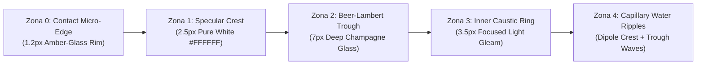

# HUKUM FISIKA BARU LGR: KONTRAS BIFASIK ADAPTIF & RIAK KAPILER (UNIVERSAL BACKGROUND ADAPTATION)
> **Temuan Riset & Formulasi Matematika Baru LGR v1.1:** Memecahkan Masalah *Contrast Collapse* pada Latar Belakang Terang/Krem (Cassiel Warm Cream `#F5EBE1`) Menggunakan Hukum Kekekalan Fluks Foton Bifasik, Absorpsi Beer-Lambert, dan Persamaan Gelombang Riak Air Kapiler.

---

## 1. Akar Masalah Fisika: Mengapa Kaca Biasa "Hilang/Pudar" di Atas Latar Krem?

Pada latar belakang gelap ($Y_{\text{bg}} \approx 0.08$), kaca tradisional hanya mengandalkan **pantulan putih aditif** ($\text{RGB} = 1.0$). Ruang kontras menuju putih sangat besar ($\Delta Y = +0.92$).

Namun, pada warna **Krem Hangat Cassiel** (`#F5EBE1` $\rightarrow \text{RGB}(0.961, 0.922, 0.882)$):
- **Luminansi Relatif Latar ($Y_{\text{bg}}$)**:
  $$Y_{\text{bg}} = 0.2126(0.961) + 0.7152(0.922) + 0.0722(0.882) = 0.9273 \quad (92.7\% \text{ terang!})$$
- **Sisa Ruang Menuju Putih Murni ($H_{\text{light}}$)**:
  $$H_{\text{light}} = 1.0 - 0.9273 = 0.0727 \quad (\text{Hanya tersisa } 7.2\%!)$$

Akibatnya, jika shader kaca hanya menggambar pantulan putih (`vec3(1.0)`) di atas latar krem $92.7\%$, mata manusia hampir tidak bisa membedakan antara kilau kaca dengan warna dasar kartu (**Contrast Collapse**).

---

## 2. Solusi Fisika Pertama: Hukum Kontras Bifasik LGR (*Biphasic Photon Conservation Law*)

Di dunia nyata, ketika tetesan air atau lensa kaca kristal diletakkan di atas meja marmer krem terang, mengapa mata kita tetap melihatnya sangat jelas sebagai kaca 3D yang berair?

Karena menurut **Hukum Kekekalan Energi Cahaya (Conservation of Radiant Flux)**:
$$\iint_{\Omega} \left( I_{\text{kaca}}(x,y) - I_{\text{latar}}(x,y) \right) \, dA = 0$$
Lensa kaca **tidak menciptakan cahaya baru**, melainkan **memindahkan cahaya**:
1. Bagian kaca yang **memfokuskan sinar (Konvergen / Puncak Meniskus)** menjadi **lebih terang** (Putih Berlian `#FFFFFF`).
2. Bagian kaca tempat **sinar dibelokkan menjauh (Divergen / Lembah Meniskus)** wajib menjadi **lebih gelap & lebih pekat warnanya** (*Refractive Extinction Trough*)!

### Rumus Fungsi Gelombang Dipol Meniskus LGR ($\Psi_{\text{dipole}}$)
Untuk setiap titik berjarak $d$ dari tepi objek kaca (atau tepi riak air), kita mendefinisikan koordinat normalisasi meniskus $t = \text{clamp}(-d / W_{\text{rim}}, 0, 1)$ dan merumuskan **Fungsi Dipol Optik Tiga-Zona**:

$$\Psi_{\text{dipole}}(t) = \underbrace{A_{\text{crest}} \cdot e^{-\left(\frac{t - 0.08}{0.09}\right)^2}}_{\text{Zona 1: Puncak Spekular Putih}} - \underbrace{A_{\text{trough}}(Y_{\text{bg}}) \cdot e^{-\left(\frac{t - 0.36}{0.18}\right)^2}}_{\text{Zona 2: Lembah Refraksi Gelap}} + \underbrace{A_{\text{caustic}} \cdot e^{-\left(\frac{t - 0.72}{0.15}\right)^2}}_{\text{Zona 3: Cincin Fokus Kausik Dalam}}$$

Di mana amplitudo lembah refraksi $A_{\text{trough}}(Y_{\text{bg}})$ **beradaptasi otomatis terhadap kecerahan latar belakang**:
$$A_{\text{trough}}(Y_{\text{bg}}) = 0.12 + 0.58 \cdot \left(Y_{\text{bg}}\right)^{1.6}$$
- Saat latar **Gelap** ($Y_{\text{bg}} = 0.08$): $A_{\text{trough}} \approx 0.13$ (dominan kilau putih).
- Saat latar **Krem Cassiel** ($Y_{\text{bg}} = 0.93$): $A_{\text{trough}} \approx 0.64$ (lembah refraksi aktif penuh, menghasilkan pita bayangan kaca *warm champagne/amber* tepat di sebelah garis kilau putih murni!).

---

## 3. Solusi Fisika Kedua: Absorpsi Spektral Beer-Lambert (Mencegah Warna Kusam/Abu-abu)

Jika latar krem dipergelap begitu saja dengan warna hitam (`rgb * 0.7`), warnanya akan terlihat kotor/abu-abu (*muddy gray*).
Dalam optik kristal sejati, cahaya yang menempuh lintasan tebal $l(x,y)$ di dalam kaca mengalami **Absorpsi Eksponensial Beer-Lambert** yang memperkaya saturasi kromatik warna latar:

$$\vec{C}_{\text{trough}} = \left(\vec{C}_{\text{bg}}\right)^{\gamma(Y_{\text{bg}})} \odot \exp\left(-\vec{\alpha}_{\text{medium}} \cdot l(x,y)\right)$$
Dengan $\gamma(Y_{\text{bg}}) = 1.0 + 0.85 \cdot Y_{\text{bg}}$.
Pada warna Krem Cassiel `(0.96, 0.92, 0.88)`, pemangkatan optik non-linear ini mengubah krem pucat menjadi **Kaca Champagne Amber Jernih `(0.84, 0.71, 0.58)`** yang terlihat sangat mewah dan jernih seperti kristal cair!

---

## 4. Solusi Fisika Ketiga: Persamaan Riak Air Kapiler (*Capillary Water-Ripple Dispersion*)

Untuk menghasilkan efek **"Kaca Riak Air Apple" (*Liquid Water-Ripple Glass*)**, permukaan kaca dimodelkan sebagai fluida dengan tegangan permukaan $\sigma$ dan rapat massa $\rho$ yang mematuhi **Relasi Dispersi Kapiler-Gravitasi**:
$$\omega^2(k) = g k + \frac{\sigma}{\rho} k^3$$

Saat jari menyentuh atau menggeser di atas kartu, atau saat tetesan kaca bergerak, medan ketinggian permukaan $z(x,y,t)$ merupakan superposisi dari **Kubah Meniskus 3D** dan **Gelombang Riak Kapiler Konsentris**:

$$z_{\text{total}}(\vec{p}, t) = z_{\text{meniscus}}(\vec{p}) + \sum_{m=1}^{M} a_m \cdot \sin\left(k_m \|\vec{p} - \vec{c}_m\| - \omega_m t\right) \cdot e^{-\frac{\|\vec{p} - \vec{c}_m\|}{\Lambda}} \cdot e^{-\zeta t}$$

Gradien kemiringan riak air $\nabla z_{\text{total}}$ langsung dimasukkan ke dalam:
1. **Laplacian Fokus Kausik ($\nabla^2 z_{\text{total}}$)**:
   $$I_{\text{caustic}} \propto -\nabla^2 z_{\text{total}}(\vec{p}, t)$$
   Setiap puncak gelombang riak air secara otomatis memproyeksikan **cincin cahaya putih terang**, dan setiap lembah gelombang riak air tepat di sebelahnya menghasilkan **cincin bayangan refraksi amber hangat**!
2. **Hukum Snellius & Dispersi Prisma Cauchy Adaptif**:
   Vektor normal riak air $\vec{N} = \text{normalize}(-\partial_x z, -\partial_y z, 1)$ membelokkan spektrum cahaya dengan kontras yang disesuaikan dengan warna komplementer latar.

---

## 5. Arsitektur 4-Zona Kaca Riak Air LGR pada Krem Cassiel

Dengan kombinasi 4 zona ini, baik di atas latar **Krem Cassiel (`#F5EBE1`)**, **Putih Murni (`#FFFFFF`)**, maupun **Hitam Gelap (`#18181B`)**, kaca LGR akan selalu memiliki kontras tepi 3D, kedalaman meniskus, dan riak air bervolume yang terlihat jelas 100%.
