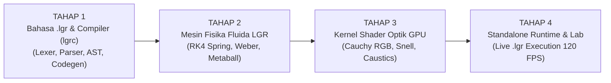

# RENCANA INDUK PEMBANGUNAN LIQUID GLASS REDI (LGR)
> **Roadmap Rekayasa Bertahap:** Dari Spesifikasi Bahasa Mandiri (`.lgr`), Compiler (`lgrc`), Mesin Fisika Hydro-Elastic, Kernel Optik GPU (Cauchy Dispersion & Analytical Caustics), hingga Runtime Mandiri.

---

## Ringkasan Tahapan Eksekusi

---

### TAHAP 1: Spesifikasi Bahasa `.lgr` & Pembuatan Compiler Mandiri (`lgrc`) — *[DIKERJAKAN SEKARANG]*
**Tujuan**: Menciptakan bahasa deklaratif-fisika mandiri dengan ekstensi `.lgr` yang tidak bergantung pada aturan CSS/React, lengkap dengan compiler yang mengubah kode `.lgr` menjadi Abstract Syntax Tree (AST) dan instruksi seragam GPU (*GPU Uniforms & Shader Pipeline*).

1. **Spesifikasi Tata Bahasa Formal (`LGR_LANGUAGE_SPEC.md`)**:
   - Kata kunci utama (*keywords*): `material`, `optics`, `fluid`, `lighting`, `caustics`, `scene`, `vessel`, `droplet`, `behavior`.
   - Tipe data fisik bawaan: satuan panjang (`px`, `%`), sudut (`deg`, `rad`), panjang gelombang (`nm`), indeks bias (`ior`), rasio tanpa dimensi, vektor (`vec2`, `vec3`, `rgba`), dan warna heksadesimal.
   - Ekspresi deklaratif hukum fisika: `snell_cauchy`, `fresnel_schlick`, `weber_navier`, `marangoni_coalescence`, `jacobian_caustics`.
2. **Arsitektur Compiler `lgrc` (`compiler/`)**:
   - `lexer.js`: Mengubah teks mentah `.lgr` menjadi aliran token dengan pelacakan baris & kolom yang presisi.
   - `parser.js`: Membangun pohon sintaks abstrak (AST) dari token dan memvalidasi struktur blok.
   - `analyzer.js`: Memvalidasi hukum fisika (misal: memastikan indeks bias $n \ge 1.0$, mengecek konservasi volume Weber, menghitung otomatis $F_0 = ((1-n)/(1+n))^2$ dan rasio dispersi spektral Cauchy $\eta_R, \eta_G, \eta_B$).
   - `codegen.js`: Mengompilasi AST yang telah divalidasi menjadi **LGR Binary/JSON IR (Intermediate Representation)** dan menghasilkan kode **Hardware GLSL / WGSL Shader** khusus sesuai parameter material `.lgr`.
3. **Pengujian & Contoh Kode `.lgr` (`examples/` & `compiler/test-compiler.js`)**:
   - Membuat sampel program `.lgr` pertama (`crystal_dock.lgr`).
   - Menjalankan verifikasi kompilasi otomatis.

---

### TAHAP 2: Mesin Matematika & Fisika Fluida LGR (`physics/`) — *[TAHAP BERIKUTNYA]*
**Tujuan**: Membangun mesin simulasi mekanika fluida dan interaksi gestur yang melampaui pegas standar Apple.

1. **Sub-Stepped RK4 & Velocity Verlet Integrator (`integrator.js`)**:
   - Integrasi numerik orde-4 yang bebas dari ketidakstabilan pada *frame rate* variabel (60Hz / 90Hz / 120Hz / 144Hz).
2. **Navier-Stokes Volume-Invariant Solver (`hydrodynamics.js`)**:
   - Perhitungan Bilangan Weber ($We$), regangan longitudinal $S_x$, kompresi transversal $S_y$, dan kemiringan geser inersia ($\theta_{\text{tilt}}$).
   - Penegakan invarian *Resting State 1:1* ($\text{scale} = 1.0000$, $\text{offset} = 0.0\text{px}$ saat energi kinetik mencapai nol).
3. **Marangoni Surface Tension & Metaball Coalescence (`metaballs.js`)**:
   - Medan skalar potensial dan operator *Polynomial Smooth Minimum* ($smin_k$) untuk memungkinkan dua atau lebih tetesan kaca saling menarik, membentuk leher cairan (*liquid necking*), menyatu, dan memisah (*snap*).

---

### TAHAP 3: Kernel Shader Optik GPU LGR (`shaders/`)
**Tujuan**: Merumuskan matematika shader per-piksel yang mengalahkan kualitas visual Metal Apple.

1. **Cauchy Tri-Band Chromatic Refraction**:
   - Pembiasan sinar terpisah untuk spektrum Merah ($\lambda = 650\text{nm}$), Hijau ($\lambda = 550\text{nm}$), dan Biru ($\lambda = 450\text{nm}$).
2. **Analytical Meniscus Normal & Total Internal Reflection (TIR)**:
   - Rekonstruksi kubah 3D dari jarak SDF gabungan dan pantulan internal sempurna pada tepi lengkung ekstrem.
3. **Analytical Jacobian Forward Caustics**:
   - Menghitung determinan matriks Hessian permukaan kaca untuk memproyeksikan pola fokus cahaya nyata di lantai dasar.
4. **4-Light Studio PBR + Bernoulli Stagnation Glint**:
   - Pencahayaan spekular multi-arah dinamis yang merespons kecepatan dan kemiringan cairan.

---

### TAHAP 4: LGR Standalone Runtime & Laboratorium Visual Interaktif (`runtime/` & `lab/`)
**Tujuan**: Menghidupkan kode `.lgr` secara langsung di layar dengan akselerasi penuh GPU tanpa ketergantungan framework eksternal.

1. **LGR Runtime Engine**: Membaca output compiler `lgrc`, menginisialisasi konteks GPU (WebGL2 / WebGPU), menjalankan loop fisika 120 FPS, dan menangkap input pointer/sentuhan 1:1.
2. **LGR Interactive Workbench**: Antarmuka laboratorium untuk menulis/mengubah kode `.lgr` secara langsung, menguji penyatuan tetesan kaca (*metaball fusion*), dispersi pelangi kristal, dan membandingkan *Apple Standard Mode* vs *LGR Beyond-Apple Mode*.
