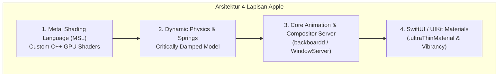
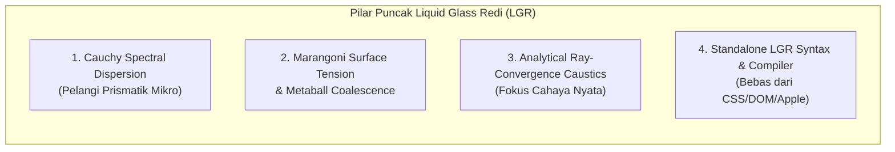

# LIQUID GLASS REDI (LGR) — RESEARCH MASTER & ARSITEKTUR ACUAN
> **Dokumen Riset Fundamental & Analisis Komparatif:** Membedah Struktur Fisika, Matematika, Optik, Shading, dan Pipeline Rendering Apple visionOS & iOS 26 untuk Dikembangkan Melampaui Batas Aslinya Menjadi Bahasa & Engine Mandiri **Liquid Glass Redi (LGR)**.

---

## 1. PENDAHULUAN & MISI UTAMA LGR

Tujuan proyek **Liquid Glass Redi ("LGR")** adalah memecahkan batasan industri grafis antarmuka saat ini:
1. **Bebas dari Keterikatan Apple**: Tidak membutuhkan MacOS, tidak membutuhkan chip Apple Silicon (M-series/A-series), dan tidak bergantung pada API tertutup Metal Shading Language.
2. **Bebas dari Render Offline 3D**: Bukan animasi video pre-rendered (seperti Blender/After Effects), melainkan **komputasi fisika analitis langsung di GPU (real-time 60–120 FPS)**.
3. **Bebas dari Ketergantungan Kode Pihak Ketiga**: Menolak batasan DOM HTML/CSS konvensional yang kaku. LGR dipersiapkan sebagai bahasa dan engine grafis yang **berdiri sendiri (standalone)**.
4. **Melampaui Teknologi Apple**: Mengidentifikasi kompromi dan keterbatasan yang diambil Apple demi efisiensi baterai, lalu menyempurnakannya dengan fisika optik sejati yang belum pernah diimplementasikan dalam kode antarmuka sebelumnya.

---

## 2. BEDAH STRUKTUR RESMI APPLE (REFERENSI DASAR)

Apple mengimplementasikan *Liquid Glass* pada Apple Vision Pro (visionOS) dan iOS 26 dengan mengintegrasikan 4 pilar utama:

### 2.1. Matematika Geometri & Analitis 3D (Signed Distance Fields / SDF)
Apple tidak membuat jaring poligon 3D (mesh segitiga) untuk setiap tombol kaca, karena mesh poligon akan membebani memori dan menghasilkan tepian bergerigi (*aliasing*). Sebagai gantinya, Apple menggunakan **Signed Distance Fields (SDF)** matematis:

1. **Analytical Capsule SDF**:
   Jarak titik sembarang $p(x, y)$ terhadap kapsul berukuran setengah panjang $b$ dan radius $r$:
   $$d(p, b, r) = \|\max(|p| - b, \vec{0})\| + \min(\max(|p_x| - b_x, |p_y| - b_y), 0) - r$$
2. **Kubah Meniskus Kaca 3D (*Meniscus Dome Heightmap*)**:
   Dari nilai $d$, kedalaman kelengkungan kaca $z$ dihitung secara kontinu:
   $$t_{\text{rim}} = \text{clamp}\left(\frac{-d}{\text{rimWidth}}, 0.0, 1.0\right)$$
   $$z_{\text{rim}} = \sqrt{\max(0.004, 1.0 - (1 - t_{\text{rim}})^2)}$$
   $$\text{Kemiringan Kaca (Meniscus Slope)} = \frac{1 - t_{\text{rim}}}{\max(0.20, z_{\text{rim}})}$$
3. **Vektor Normal Permukaan 3D ($\vec{N}$)**:
   $$N_{xy} = \nabla d \cdot \text{Slope} + \text{DomeCoordinate}$$
   $$\vec{N} = \text{normalize}(N_x, N_y, 1.0)$$
   Vektor $\vec{N}$ inilah yang menentukan ke mana arah cahaya akan dibelokkan ketika menabrak permukaan kaca.

---

### 2.2. Fisika Fluida & Dinamika Gerak (Hydrodynamics)

Ketika elemen kaca berpindah atau digeser jari, ia tidak bergerak seperti balok padat kaku, melainkan seperti tetesan cairan kental (*liquid bead*).

1. **Hukum Kekekalan Volume Fluida (Incompressible Navier-Stokes & Bilangan Weber $We$)**:
   Fluida tak termampatkan memiliki volume konstan ($V = X \cdot Y \cdot Z = \text{konstan}$).
   Ketika bergerak horizontal pada kecepatan $v_x$, rasio inersia terhadap tegangan permukaan diukur oleh Bilangan Weber:
   $$We = \tanh\left(\frac{|v_x|}{v_{\text{char}}}\right)$$
   * **Peregangan Searah Gerak (Sumbu X)**:
     $$S_x = \sqrt{1 + 0.28 We}$$
   * **Penyusutan Tegak Lurus (Sumbu Y - Volume Invariant)**:
     $$S_y = \frac{1}{\sqrt{1 + 0.14 We}}$$
     *(Jika kaca melar menyamping, ketebalannya wajib menipis secara otomatis agar massanya tetap sama).*
2. **Kemiringan Inersia Geser (*Dynamic Shear Tilt*)**:
   Cairan memiliki massa, sehingga bagian puncak cairan tertinggal sesaat sebelum menabrak batas kapsul:
   $$\theta_{\text{tilt}} = \tanh\left(\frac{0.75 v_x + 0.018 a_x}{680}\right)$$

---

### 2.3. Fisika Optik & Refraksi (Snellius & Schlick)

1. **Hukum Snellius Hardware ($n = 1.52$ - Crown Crystal Glass)**:
   Cahaya dari antarmuka di bawah kaca dibelokkan saat menembus meniskus:
   $$n_1 \sin(\theta_1) = n_2 \sin(\theta_2) \implies \vec{R}_{\text{refract}} = \text{refract}(\vec{I}, \vec{N}, \eta_{\text{ratio}})$$
   dengan $\vec{I} = (0, 0, -1)$ dan $\eta_{\text{ratio}} = \frac{1.0}{1.52} = 0.6579$.
2. **Aproksimasi Fresnel Schlick (Kilau Tepi Glancing Angle)**:
   Reflektansi permukaan meningkat drastis pada sudut pandang miring di tepi batas kapsul:
   $$R(\theta) = F_0 + (1 - F_0)(1 - \cos\theta)^5$$
   Untuk kaca kristal ($n = 1.52$), nilai dasar reflektansi normal adalah:
   $$F_0 = \left(\frac{1.0 - 1.52}{1.0 + 1.52}\right)^2 = 0.0426 \quad (4.26\%)$$

---

### 2.4. Pencahayaan Fotorealistik Multi-Arah (PBR Blinn-Phong)

Apple menolak pencahayaan datar ambient. Setiap kubah kaca disinari oleh **4 sumber cahaya terkoordinasi**:
1. **Overhead Key Light**: Lampu utama dari sudut atas-depan yang bergerak bergeser mengikuti kemiringan inersia fluida ($\text{exponent } 54.0$).
2. **Crown Specular Shelf**: Kilauan melengkung lembut di bibir atas kaca ($\text{exponent } 14.0$).
3. **Subsurface Bottom Rim Bounce**: Pantulan cahaya dari lantai dasar antarmuka ke bawah lengkungan kaca ($\text{exponent } 34.0$) untuk memberikan bobot fisik agar kaca tidak terasa melayang hampa.
4. **Bernoulli Leading-Edge Stagnation**: Kilatan tajam di ujung depan tetesan saat sedang meluncur cepat ($\text{exponent } 22.0 \cdot |\theta_{\text{tilt}}|$).

---

### 2.5. Transisi & Mekanika Interaksi Gestur

1. **Invarian Keseimbangan 1:1 saat Diam (*Resting State Alignment*)**:
   Saat kaca berhenti di atas salah satu menu, pembesaran optik wajib tepat **`1.0000`** dan translasi vertikal wajib **`0.0px`**. Ikon harus duduk di garis horizontal yang sama persis dengan ikon di sebelahnya. Efek membesar (hingga 1.18x) dan elevasi maju 3D hanya boleh muncul saat disentuh atau sedang meluncur.
2. **Interruptibility Mutlak**:
   Setiap animasi kaca dapat dicegat dan dibalikkan arahnya di tengah jalan (*mid-flight*) tanpa menunggu animasi selesai. Kecepatan jari saat melepaskan sentuhan langsung diwariskan ke pegas (*velocity handoff*).
3. **Proyeksi Momentum Eksponensial**:
   Apple tidak memakai rumus fisika kaku $v^2 / (2a)$, melainkan peluruhan eksponensial:
   $$\text{Jarak Lemparan} = \left(\frac{v_{\text{initial}}}{1000}\right) \cdot \frac{d}{1 - d}, \quad \text{dengan } d \approx 0.998$$

---

## 3. ANALISIS KETERBATASAN APPLE: APA KOMPROMI MEREKA?

Untuk melampaui Apple, kita harus memahami di mana titik lemah sistem mereka saat ini:

1. **Refraksi Monokromatik (Tanpa Dispersi Kromatik)**:
   Apple menggunakan indeks bias tunggal ($\eta = 0.6579$). Akibatnya, kaca Apple terlihat seperti plastik akrilik bening biasa, bukan kaca kristal optik sejati yang mampu menguraikan cahaya menjadi spektrum pelangi mikro (*chromatic aberration*).
2. **Bentuk Geometri Kaku (Tanpa Koalesensi Fluida / Metaballs)**:
   Kaca Apple hanya berupa kapsul tunggal yang bergeser. Dua tombol kaca Apple yang berdekatan tidak bisa saling menarik, meregang, atau menyatu elastis seperti tetesan air raksa riil.
3. **Kausik Cahaya Statis (Tanpa Dynamic Caustic Focusing)**:
   Apple memalsukan kilau bawah (*caustic*) menggunakan fungsi gradien radial sederhana, bukan menghitung konvergensi sinar cahaya yang terfokus (*concentrated ray caustics*).
4. **Terkurung di Ekosistem Tertutup**:
   Teknologi ini hanya hidup di dalam framework privat Apple (Metal, UIKit, visionOS WindowServer). Pengembang di platform lain tidak memiliki akses ke pipeline ini.

---

## 4. CETAK BIRU LIQUID GLASS REDI (LGR): MELAMPAUI APPLE

Inilah inovasi fisika dan arsitektur yang akan kita kembangkan di dalam engine LGR:

### 4.1. Dispersi Kromatik Cauchy (*Prismatic Micro-Flares*)
LGR membagi berkas refraksi menjadi 3 panjang gelombang spektrum cahaya ($R, G, B$) menggunakan Persamaan Cauchy:
$$n(\lambda) = A + \frac{B}{\lambda^2}$$
* Indeks Bias Merah ($\lambda_R = 650\text{ nm}$): $n_R = 1.514$
* Indeks Bias Hijau ($\lambda_G = 550\text{ nm}$): $n_G = 1.520$
* Indeks Bias Biru ($\lambda_B = 450\text{ nm}$): $n_B = 1.528$

*Hasil pada LGR*: Saat kaca meluncur cepat atau saat cahaya menembus sudut miring meniskus, tepi kaca LGR akan memancarkan kilauan spektrum pelangi mikro yang sangat mewah—efek kristal sejati yang tidak dimiliki Apple!

---

### 4.2. Koalesensi Fluida & Tegangan Permukaan Marangoni (*Metaballs*)
LGR mengimplementasikan fungsi medan skalar potensial fluida:
$$f(p) = \sum_{i=1}^{k} \frac{R_i^2}{\|p - c_i\|^2}$$
Dua tetesan kaca yang didekatkan akan membentuk jembatan cairan elastis (*liquid necking*) sebelum menyatu secara sempurna, dan saat dipisahkan akan meregang elastis dengan resistensi tegangan permukaan sebelum putus (*droplet snap*).

---

### 4.3. Kausik Konvergensi Sinar Analitis (*Forward Ray Caustics*)
LGR menghitung kerapatan fluks foton di bawah lensa kaca:
$$\Phi(x, y) \propto \det\left(\mathbf{I} + \nabla \vec{R}_{\text{refract}}\right)^{-1}$$
Lantai dasar antarmuka di bawah kaca LGR akan menerima garis fokus cahaya terang yang dinamis mengikuti kelengkungan kubah kaca dan arah datang cahaya matahari/lampu.

---

### 4.4. Arsitektur Kompilasi & Standalone Engine LGR
LGR dirancang dengan pipeline mandiri:
* **LGR Source (`.lgr`)**: File teks deklaratif yang mendefinisikan material optik dan perilaku fluida.
* **LGR Lexer & Parser**: Mengurai sintaks LGR menjadi struktur AST grafis.
* **LGR Hardware Backend**: Mengompilasi AST langsung ke **SPIR-V / GLSL ES 3.0 / WGSL (WebGPU)** yang dapat dieksekusi di Windows (DirectX/Vulkan), Android (Vulkan/OpenGL ES), maupun Web (WebGPU/WebGL2) dengan performa 120 FPS tanpa overhead CPU.

---

## 5. KESIMPULAN & TAHAP RISET BERIKUTNYA

Dokumen riset ini menjadi **fondasi data dan acuan permanen** proyek LGR di folder `liquid-glass-redi`. 

Seluruh pengembangan formula, kalkulasi matematis, dan pembentukan tata bahasa LGR selanjutnya akan mengacu pada hukum fisika dan inovasi yang telah dirangkum dalam dokumen ini.
