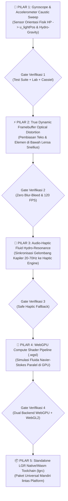

# MASTER BLUEPRINT EKSPERIMEN LGR v2.0 — 5 PILAR PENINGKATAN (ZERO-REGRESSION ARCHITECTURE)

> **Prinsip Utama Rekayasa (Anti-Breakage Invariant):**
> Setiap peningkatan (Pilar 1 s.d. Pilar 5) dibangun menggunakan arsitektur **Additive Non-Destructive Layering** (Lapisan Tambahan Tanpa Merusak). Jika sensor perangkat keras atau API baru tidak tersedia di suatu perangkat (misal PC desktop tanpa gyroscope atau browser lama tanpa WebGPU), sistem wajib memiliki **Graceful Physical Fallback** otomatis ke state stabil sebelumnya dan wajib lulus 100% pengujian `test-suite.js` sebelum dinyatakan selesai.

---

## Peta Jalan Bertahap (Sequential Upgrade Pipeline)

---

## 🌊 PILAR 1: Gyroscope & Accelerometer Physical Caustic Sweep (DIKERJAKAN PERTAMA)

### 1. Rumusan Fisika & Matematika Baru
Di dunia nyata, ketika sebuah kristal cair atau tetesan air berada di atas permukaan kartu dan pengguna memiringkan HP sebesar sudut *roll* ($\gamma \in [-90^\circ, 90^\circ]$) dan *pitch* ($\beta \in [-180^\circ, 180^\circ]$):

1. **Vektor Cahaya Ruang Fisik ($\vec{L}_{\text{world}}$)**:
   Sumber cahaya ruangan tetap diam di atas kepala pengguna, sehingga di dalam kerangka acuan layar HP yang miring, vektor arah datang cahaya $\vec{L}_{\text{gyro}}$ bergeser mengikuti matriks rotasi Euler:
   $$\vec{L}_{\text{gyro}}(\beta, \gamma) = \text{normalize}\begin{pmatrix} -\sin(\gamma) \cdot S_{\text{gyro}} - \tau_x \\ -\sin(\beta - \beta_0) \cdot S_{\text{gyro}} - 0.72 - \tau_y \\ \cos(\gamma)\cos(\beta - \beta_0) \end{pmatrix}$$
   Di mana $\beta_0 \approx 35^\circ$ adalah sudut pegangan ergonomis alami tangan manusia saat menatap layar HP, dan $S_{\text{gyro}}$ adalah sensitivitas optik.

2. **Pergeseran Fokus Kaustik & Pergerakan Meniskus Hidro-Gravitasi ($\Delta \vec{p}_{\text{caustic}}$)**:
   Kemiringan gravitasi efektif $\vec{g}_{\text{eff}} = (g \sin\gamma, g \sin(\beta - \beta_0))$ menekan cairan kaca ke sisi bawah kemiringan, menggeser cincin fokus kaustik lantai sejauh:
   $$\Delta \vec{p}_{\text{caustic}} = h_{\text{focus}} \cdot \tan\left(\arcsin\left(\frac{\sin\theta_{\text{gyro}}}{n_{\text{crystal}}}\right)\right)$$

3. **Filter Redaman Inersia RK4 ($\text{RK4GyroFilter}$)**:
   Data mentah sensor gyroscope/accelerometer memiliki *jitter* mikro. Sebelum masuk ke shader `u_lightPos` dan `u_gyroTilt`, sinyal dilewatkan ke pegas RK4 berfrekuensi alami $\omega_n = 18.5\text{ rad/s}$ ($\zeta = 0.92$) agar pergerakan kilau kaca sehalus air raksa.

### 2. Cakupan Implementasi Pilar 1
- **Bahasa `.lgr` & Compiler (`compiler/`)**: Menambahkan properti opsional `gyroSensitivity` dan `ergonomicPitch` pada blok `lighting` / `optics` beserta penurunan uniform `u_lightPos` & `u_gyroTilt`.
- **Mesin Fisika (`physics/hydroEngine.js`)**: Menambahkan kelas `LGRGyroscopeController` yang menangani:
  - Sensor `DeviceOrientationEvent` & `DeviceMotionEvent` asli di HP (Android/iOS).
  - Izin sensor iOS 13+ (`DeviceOrientationEvent.requestPermission`) secara aman.
  - Kalibrasi otomatis titik nol (*Auto-Zero Ergonomic Pitch Baseline*).
  - Mode *Virtual 3D Gyro Simulator* untuk pengujian di PC/Browser tanpa perlu memutar layar monitor.
- **Shader Optik GPU (`shaders/opticalKernel.js` & `src/utils/lgrHeroGlass.js`)**:
  - Menambahkan `uniform vec3 u_lightPos` dan `uniform vec2 u_gyroTilt`.
  - Menggerakkan pantulan utama (*Key Specular*), *Crown Shelf*, *Bernoulli Glint*, pendaran prisma Cauchy, serta cincin kaustik lantai secara *real-time* saat HP dimiringkan.
- **Workbench Interaktif (`lab/index.html`)**:
  - Menambahkan bola/kompas **3D Gyroscope Tilt Simulator** dan indikator sudut $(\beta^\circ, \gamma^\circ)$ secara langsung di laboratorium `http://localhost:4321/lab/index.html`.

### 3. Jaminan Anti-Rusak (Zero-Regression Guard Pilar 1)
- Jika `u_lightPos` bernilai default `(0, 0, 0)` atau perangkat tidak memiliki gyroscope dan simulator berada di `(0°, 0°)`, persamaan $\vec{L}_{\text{gyro}}$ menghasilkan nilai **100% identik** dengan vektor cahaya statis sebelumnya.
- Saat kartu berada dalam keadaan diam dan tidak dimiringkan, loop `requestAnimationFrame` otomatis tidur (*auto-sleep*) untuk menghemat baterai 0% CPU/GPU.

---

## ⚡ PILAR 2: True Dynamic Framebuffer Optical Distortion (Membelokkan Teks di Bawah Kaca)
- **Konsep**: Merender lapisan tipografi/elemen di bawah lensa ke dalam tekstur WebGL (*Scene Framebuffer Texture*) dan menerapkan pembiasan vektor normal 3D $\Delta \vec{u} = \left(\frac{n_{\text{air}} - n_{\text{glass}}(\lambda)}{n_{\text{glass}}(\lambda)}\right) \nabla z(x,y)$ sehingga huruf dan angka di balik kapsul kaca benar-benar meliuk mengikuti kelengkungan lensa air saat digeser.
- **Jaminan Anti-Rusak**: Pada saat istirahat (*Resting State*), invarian 1:1 tetap mengunci pembesaran tepat pada $1.0000\times$ sehingga teks tetap tajam 100% tanpa blur.

---

## 📳 PILAR 3: Audio-Haptic Fluid Hydro-Resonance (Sensasi Fisik Riak Air di Ujung Jari)
- **Konsep**: Mengonversi energi kinetik gelombang kapiler ($E_k = \frac{1}{2} m v^2$) dan tabrakan penyatuan tetesan (*Marangoni Coalescence Snap*) menjadi pulsa getaran mikro terukur melalui `navigator.vibrate` / Android Haptic Waveform dan sintetis akustik frekuensi rendah WebAudio opsional.
- **Jaminan Anti-Rusak**: Dibungkus dalam blok `try/catch` non-blocking; tidak pernah mengganggu thread utama atau melempar error di browser desktop yang tidak memiliki motor getar.

---

## 🚀 PILAR 4: WebGPU Compute Shader Pipeline (`.wgsl`)
- **Konsep**: Menyediakan backend ganda (*Dual-Backend Engine*): jika browser/perangkat mendukung `navigator.gpu` (WebGPU), simulasi persamaan gelombang air 2D (*2D Shallow Water / Capillary Wave PDE*) dieksekusi di Compute Shader `.wgsl`. Jika tidak, otomatis jatuh kembali (*fallback*) ke WebGL2 GLSL 300 ES.
- **Jaminan Anti-Rusak**: Kompatibilitas mundur 100% dengan WebGL2 dan WebGL1 yang sudah berjalan saat ini.

---

## 📦 PILAR 5: Standalone LGR WebAssembly / Native Toolchain (`lgrc`)
- **Konsep**: Membungkus compiler `lgrc` dan runtime fisika-optik ke dalam modul SDK mandiri (`lgr-engine.esm.js` & target Wasm/C-ABI) dengan dokumentasi API lengkap sehingga siap dipasang di aplikasi apa pun hanya dengan 1 baris kode.
- **Jaminan Anti-Rusak**: Seluruh file sumber `.lgr` yang sudah ditulis tetap kompatibel 100%.
