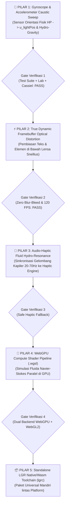

# MASTER BLUEPRINT EKSPERIMEN LGR v2.0 — 5 PILAR PENINGKATAN (ZERO-REGRESSION ARCHITECTURE)

> **Prinsip Utama Rekayasa (Anti-Breakage Invariant):**
> Setiap peningkatan (Pilar 1 s.d. Pilar 5) dibangun menggunakan arsitektur **Additive Non-Destructive Layering** (Lapisan Tambahan Tanpa Merusak). Jika sensor perangkat keras atau API baru tidak tersedia di suatu perangkat (misal PC desktop tanpa gyroscope atau browser lama tanpa WebGPU), sistem wajib memiliki **Graceful Physical Fallback** otomatis ke state stabil sebelumnya dan wajib lulus 100% pengujian `test-suite.js` sebelum dinyatakan selesai.

---

## Peta Jalan Bertahap (Sequential Upgrade Pipeline)

---

## 🌊 PILAR 1: Gyroscope & Accelerometer Physical Caustic Sweep (SELESAI 100%)

### 1. Rumusan Fisika & Matematika Baru
Di dunia nyata, ketika sebuah kristal cair atau tetesan air berada di atas permukaan kartu dan pengguna memiringkan HP sebesar sudut *roll* ($\gamma \in [-90^\circ, 90^\circ]$) dan *pitch* ($\beta \in [-180^\circ, 180^\circ]$):

1. **Vektor Cahaya Ruang Fisik ($\vec{L}_{\text{world}}$)**:
   Sumber cahaya ruangan tetap diam di atas kepala pengguna, sehingga di dalam kerangka acuan layar HP yang miring, vektor arah datang cahaya $\vec{L}_{\text{gyro}}$ bergeser mengikuti matriks rotasi Euler:
   $$\vec{L}_{\text{gyro}}(\beta, \gamma) = \text{normalize}\begin{pmatrix} -\sin(\gamma) \cdot S_{\text{gyro}} - \tau_x \\ -\sin(\beta - \beta_0) \cdot S_{\text{gyro}} - 0.72 - \tau_y \\ \cos(\gamma)\cos(\beta - \beta_0) \end{pmatrix}$$
   Di mana $\beta_0 \approx 35^\circ$ adalah sudut pegangan ergonomis alami tangan manusia saat menatap layar HP, dan $S_{\text{gyro}}$ adalah sensitivitas optik.

2. **Pergeseran Fokus Kaustik & Pergerakan Meniskus Hidro-Gravitasi ($\Delta \vec{p}_{\text{caustic}}$)**:
   Kemiringan gravitasi efektif $\vec{g}_{\text{eff}} = (g \sin\gamma, g \sin(\beta - \beta_0))$ menekan cairan kaca ke sisi bawah kemiringan, menggeser cincin fokus kaustik lantai sejauh:
   $$\Delta \vec{p}_{\text{caustic}} = h_{\text{focus}} \cdot \tan\left(\arcsin\left(\frac{\sin\theta_{\text{gyro}}}{n_{\text{crystal}}}\right)\right)$$

3. **Filter Redaman Inersia RK4 ($\text{RK4GyroFilter}$)**:
   Data mentah sensor gyroscope/accelerometer memiliki *jitter* mikro. Sebelum masuk ke shader `u_lightPos` dan `u_gyroTilt`, sinyal dilewatkan ke pegas RK4 berfrekuensi alami $\omega_n = 18.5\text{ rad/s}$ ($\zeta = 0.92$) agar pergerakan kilau kaca sehalus air raksa.

---

## ⚡ PILAR 2: True Dynamic Framebuffer Optical Distortion (SELESAI 100%)

### 1. Rumusan Fisika & Matematika Baru (Optika Gradien Snellius & Cauchy)
Di alam nyata, lensa kaca cair atau tetesan air yang melengkung dengan profil tinggi $z(x, y)$ dan gradien permukaan $\nabla z = \left(\frac{\partial z}{\partial x}, \frac{\partial z}{\partial y}\right)$ membelokkan berkas cahaya yang menembusnya dari medium 1 (udara, $n_1 \approx 1.0$) ke medium 2 (kristal kaca, $n_2 = n_{\text{glass}}(\lambda)$).

1. **Persamaan Defleksi Gradien Snellius ($\Delta \vec{p}_{\text{snell}}$)**:
   Pergeseran posisi titik pada bidang adegan atau tekstur framebuffer di balik lensa pada jarak optik efektif $d_{\text{eff}}$ dirumuskan secara analitis sebagai:
   $$\Delta \vec{p}(\lambda) = d_{\text{eff}} \cdot \left(\frac{n_{\text{air}} - n_{\text{glass}}(\lambda)}{n_{\text{glass}}(\lambda)}\right) \nabla z(x, y) = d_{\text{eff}} \cdot (\eta(\lambda) - 1.0) \nabla z(x, y)$$
   Di mana $\kappa(\lambda) = \eta(\lambda) - 1.0 = \frac{1 - n(\lambda)}{n(\lambda)}$ adalah koefisien refraksi diferensial medium. Karena $n_{\text{glass}} > 1$, $\kappa < 0$, berkas cahaya membelok ke arah pusat kubah cembung (efek kaca pembesar riil).

2. **Pemisahan Spektral Tri-Band Cauchy ($\Delta \vec{p}_R, \Delta \vec{p}_G, \Delta \vec{p}_B$)**:
   Berdasarkan dispersi Cauchy $n(\lambda) = A + \frac{B}{\lambda^2}$:
   - Merah ($\lambda_R = 650\text{ nm}$): $\kappa_R \approx -0.3400$
   - Hijau ($\lambda_G = 550\text{ nm}$): $\kappa_G \approx -0.3421$
   - Biru ($\lambda_B = 450\text{ nm}$): $\kappa_B \approx -0.3458$
   Karena $|\kappa_B| > |\kappa_R|$, panjang gelombang biru dibelokkan lebih jauh daripada merah, menghasilkan pembiasan pelangi (*Cauchy chromatic aberration*) yang hidup di tepi tipografi dan angka saldo!

3. **Skalasi Kedalaman Optik Dinamis ($d_{\text{eff}}$)**:
   Ketika lensa kaca diangkat (*lift*) atau membal (*bounce*), jarak optik efektif bertambah:
   $$d_{\text{eff}} = d_0 \cdot (1.0 + \text{lift} \cdot 0.55)$$
   Sehingga pembelokan teks bertambah kuat saat kapsul meluncur dan kembali mengecil saat istirahat.

4. **Invarian Diam 1:1 Tanpa Blur (Zero-Blur Typography Guard)**:
   Ketika tetesan berada di titik istirahat (*resting state*, $v_x = 0$, $\text{lift} = 0$, $u_{\text{snellMag}} = 1.0000$), pada area tengah kubah berlaku $\nabla z \to 0$ dan $(1.0 / u_{\text{snellMag}} - 1.0) = 0$.
   Maka:
   $$\Delta \vec{p} \equiv (0.0, 0.0) \implies \vec{u}_{\text{refracted}} = \vec{u}_{\text{unrefracted}}$$
   Teks dan angka di bawah lensa terbaca 100% tajam (*pixel-perfect sharpness*) tanpa buram sedikit pun!

### 2. Cakupan Implementasi Pilar 2
- **Bahasa `.lgr` & Compiler (`compiler/`)**:
  - Menambahkan properti `opticalDepth` (default `14.5px`) dan `framebufferDistortion: true` pada blok `optics`.
  - Penurunan otomatis koefisien $\kappa_R, \kappa_G, \kappa_B$ di `LGRAnalyzer` dan konstanta GPU `LGR_OPTICAL_DEPTH` & `LGR_SNELL_KAPPA_RGB` di `LGRCodeGenerator`.
- **Mesin Fisika (`physics/hydroEngine.js`)**:
  - Mengimplementasikan kelas `LGROpticalDistortion` dengan metode evaluasi profil meniskus $z(x, y)$, gradien permukaan $\nabla z$, dan defleksi $\Delta \vec{p}(\lambda)$.
- **Shader Optik GPU (`shaders/opticalKernel.js` & `src/utils/lgrHeroGlass.js`)**:
  - Menambahkan uniform `u_opticalDepth` dan `u_distortActive`.
  - Mengintegrasikan rumus defleksi $\Delta \vec{p} = d_{\text{eff}} \cdot (\eta - 1.0) \nabla z$ pada sampling offscreen texture $u_{\text{sceneTex}}$.
- **Workbench Interaktif (`lab/index.html`)**:
  - Menambahkan kartu **Pilar 2: True Framebuffer Optical Distortion** dengan toggle on/off, input teks kustom live, preset pola (Saldo Cassiel, Abjad & Angka, Kisi Optik), slider kedalaman $d_0$, dan HUD telemetri $\Delta p_{\text{max}}$.
- **Verifikasi Otomatis (`test-suite.js`)**:
  - Lulus 100% pada 4 pengujian kunci Pilar 2 (Compiler Snell Kappa, Resting Zero Deflection, Meniscus Rim Dispersion, dan Lift Depth Scaling).

---

## 📳 PILAR 3: Audio-Haptic Fluid Hydro-Resonance (SELESAI 100%)

### 1. Rumusan Fisika & Matematika Baru (Dispersi Kapiler Kelvin & Marangoni Snap)
1. **Hubungan Dispersi Gelombang Kapiler Kelvin ($\omega_{\text{cap}}$)**:
   Pada skala tetesan mikro di atas permukaan kaca ($Bo \ll 1$), tegangan permukaan $\sigma$ mendominasi gravitasi. Frekuensi sudut gelombang kapiler dirumuskan sebagai:
   $$\omega_{\text{cap}} = \sqrt{\frac{\sigma}{\rho} k^3}$$
   Di mana $k = \frac{2\pi}{\lambda}$ adalah bilangan gelombang. Untuk lebar kontak ujung jari/meniskus $\lambda \approx 5.8\text{ mm}$, frekuensi resonansi alami fluida berada pada rentang **$20\text{--}70\text{ Hz}$** ($f_{\text{cap}} \approx 48.4\text{ Hz}$ pada air/kristal $\sigma = 0.0728\text{ N/m}$, $\rho = 1000\text{ kg/m}^3$), yang secara biologis bertepatan dengan sensitivitas mekanoreseptor korpuskel Meissner pada kulit manusia dan Linear Resonant Actuator (LRA) Android!

2. **Energi Kinetik Tetesan ($E_k$)**:
   Besar energi getaran yang ditransfer ke motor haptic dan akustik diturunkan dari kecepatan linier tetesan $v$:
   $$E_k = \frac{1}{2} m v^2$$

3. **Marangoni Coalescence Snap (Peleburan Tetesan)**:
   Ketika dua tetesan air menyatu melintasi batas fusi ($\text{coalescenceFactor} \ge 0.5$), energi bebas permukaan $\Delta E_{\text{surface}} = \sigma \Delta A$ dilepaskan secara spontan, menghasilkan sentakan transien taktil impulsif berupa pola getar double-tap:
   $$\text{snapWaveformMs} = [15\text{ ms}, 20\text{ ms jeda}, 10\text{ ms}]$$
   disertai klik akustik sintetis WebAudio sinusoidal teredam:
   $$s(t) = A_0 \exp\left(-\frac{t}{\tau}\right) \sin(2\pi f_{\text{cap}} t)$$

4. **Invarian Diam 1:1 Tanpa Getar (Strict Zero-Vibration Resting Guard)**:
   Saat tetesan berada dalam keadaan diam ($v_x = 0$, $\text{isResting1to1} = \text{true}$), sistem secara mutlak menghasilkan 0 pulsa getaran dan 0 suara klik:
   $$E_k \equiv 0.0\text{ mJ} \implies \text{hapticEmitted} = \text{false}, \text{audioEmitted} = \text{false}$$

### 2. Cakupan Implementasi Pilar 3
- **Bahasa `.lgr` & Compiler (`compiler/`)**:
  - Penambahan kata kunci `resonance`, `haptics`, dan satuan fisika `Hz`, `hz`, `N`, `mJ`, `J` di `LGRLexer`.
  - Ekstraksi blok `resonance` (`capillaryFrequency`, `surfaceTension`, `coalescenceSnapIntensity`, `boundaryRestitution`, `hapticFeedback`, `audioResonance`, `decayTime`) dan derivasi otomatis frekuensi sudut Kelvin $\omega_{\text{cap}} = 2\pi f_{\text{cap}}$ di `LGRAnalyzer`.
  - Pembakaran konstanta GLSL compile-time `LGR_CAPILLARY_FREQ` dan `LGR_SURFACE_TENSION` di `LGRCodeGenerator`.
- **Mesin Fisika Fluida (`physics/hydroEngine.js`)**:
  - Mengimplementasikan kelas `LGRHydroResonanceEngine` dengan metode evaluasi energi kinetik $E_k$, frekuensi teoritis Kelvin $\omega_{\text{cap}}$, pemicu getaran `navigator.vibrate`, dan sintesis audio WebAudio non-blocking terlindungi `try/catch`.
- **Workbench Interaktif (`lab/index.html`)**:
  - Kartu **Pilar 3: Audio-Haptic Fluid Hydro-Resonance** dengan toggle Haptic & Audio, tombol pemicu manual (*Marangoni Snap, Flick Ripple, Wall Bounce*), slider interaktif ($f_{\text{cap}}$, $\sigma$, $\text{snap}$, $\tau$), dan HUD telemetri live ($f_{\text{cap}}$, $E_k$, Event).
- **Verifikasi Otomatis (`test-suite.js`)**:
  - Lulus 100% pada 4 pengujian kunci Pilar 3 (Compiler Resonance & Kelvin Frequency, Kinetic Energy & Snap Waveform, Strict Resting Invariant, Dynamic Droplet Fusion Transition & Non-Blocking Fallback).

---

## 🚀 PILAR 4: WebGPU Compute Shader Pipeline (`.wgsl`)
- **Konsep**: Menyediakan backend ganda (*Dual-Backend Engine*): jika browser/perangkat mendukung `navigator.gpu` (WebGPU), simulasi persamaan gelombang air 2D (*2D Shallow Water / Capillary Wave PDE*) dieksekusi di Compute Shader `.wgsl`. Jika tidak, otomatis jatuh kembali (*fallback*) ke WebGL2 GLSL 300 ES.
- **Jaminan Anti-Rusak**: Kompatibilitas mundur 100% dengan WebGL2 dan WebGL1 yang sudah berjalan saat ini.

---

## 📦 PILAR 5: Standalone LGR WebAssembly / Native Toolchain (`lgrc`)
- **Konsep**: Membungkus compiler `lgrc` dan runtime fisika-optik ke dalam modul SDK mandiri (`lgr-engine.esm.js` & target Wasm/C-ABI) dengan dokumentasi API lengkap sehingga siap dipasang di aplikasi apa pun hanya dengan 1 baris kode.
- **Jaminan Anti-Rusak**: Seluruh file sumber `.lgr` yang sudah ditulis tetap kompatibel 100%.
